# Terminal Profile

**An animated, terminal-style showcase for a developer's GitHub profile.**

Terminal Profile turns a GitHub profile README into a compact personal developer portfolio. The terminal window types out commands, reveals selected projects and package information, shows technical interests, and ends with a blinking cursor and a pulsing `REC` indicator.

It is intentionally a small SVG generator—not a full portfolio site or a new platform to maintain.

## The current profile concept

The starter configuration is tailored to **Ürem Sancaktutan · Senior Full Stack Developer**. It highlights areas of interest rather than presenting them as a list of claims about previous employment:

- Backend engineering with .NET and ASP.NET Core
- AI-powered applications and web development
- Software architecture, microservices, distributed systems, and scalability

The project list is intentionally curated instead of displaying every repository. The first two featured projects are:

- **[Conversa](https://github.com/codelovingcat/AI-Powered-Real-Time-Conversation-Assistant)** — an AI-powered conversation assistant built around a .NET modular monolith, with a React web client.
- **[Backend Safety Kit](https://github.com/codelovingcat/Backend-Safety-Kit)** — reusable safety and diagnostics infrastructure for ASP.NET Core applications.

A small package section highlights the Backend Safety Kit preview. Its [GitHub preview release](https://github.com/codelovingcat/Backend-Safety-Kit/releases/tag/v0.1.0-preview.1) is available; a NuGet gallery link will be added when publication is confirmed. The configuration supports that link without pretending that an unpublished package is already downloadable from NuGet.

The Snake animation is deliberately not part of this terminal showcase. Other projects, including playful game experiments, can be added later when their repository links are confirmed and there is room in the curated list.

## How it works

1. Update `data/profile.json` with your name, headline, interests, featured projects, package links, learning topics, and upcoming plans.
2. Run the Python generator. It validates the config and creates `assets/terminal.svg` plus `docs/generated-links.md`.
3. Run the tests to confirm that the SVG is valid XML, dynamic text is escaped, and configured URLs are safe HTTP(S) links.
4. GitHub Actions verifies changes on pull requests and can regenerate the output on `main`.
5. Add the generated SVG to your profile README and keep repository/package links as regular Markdown below the image for reliable navigation.

The SVG is generated from configuration so the renderer doesn't need code edits every time a project or learning goal changes.

## Run locally

Requirements: Python 3.12 (the renderer uses only the Python standard library).

    python scripts/render_profile.py
    python -m unittest discover -s tests -v

Generated files:

- `assets/terminal.svg` — terminal panel with the typing timeline, animated `REC` indicator, and blinking cursor.
- `docs/generated-links.md` — normal Markdown links produced from the same config.

To use a different configuration or output path:

    python scripts/render_profile.py --config data/profile.json --output assets/terminal.svg --links-output docs/generated-links.md

## Editing the content

- `profile.name`, `headline`, and `tagline` define the intro.
- `profile.interests` lists the topics you want to highlight.
- `projects` contains only the featured repositories—not every repo on the account.
- `packages` supports source, preview-release, and optional NuGet URLs. Keep `package_url` set to `null` until the package page is confirmed live.
- `profile.learning` and `profile.plan` can be edited without touching rendering code.

See [docs/profile-content.md](docs/profile-content.md) for notes on keeping the content accurate and public-safe.

## Design principles

- **Small and focused:** one generated profile asset and its supporting links.
- **Config-first:** profile copy and links are separate from the renderer.
- **Safe by default:** dynamic text is XML-escaped and URLs are validated before use.
- **Accessible enough to understand:** the SVG includes a title and description, while real project navigation is provided through Markdown links.
- **Honest status:** the generated display and docs distinguish preview releases from packages confirmed available on NuGet.

## Roadmap

- [x] Bootstrap the README and define the initial scope — [#1](https://github.com/codelovingcat/terminal-profile/issues/1)
- [x] Create the animated terminal SVG template — [#2](https://github.com/codelovingcat/terminal-profile/issues/2)
- [x] Add configurable featured repositories and package links — [#3](https://github.com/codelovingcat/terminal-profile/issues/3)
- [x] Add editable learning and next-plan sections — [#4](https://github.com/codelovingcat/terminal-profile/issues/4)
- [x] Automate validation and SVG generation with GitHub Actions — [#5](https://github.com/codelovingcat/terminal-profile/issues/5)

Implementation and review are tracked in the pull request that closes these issues. The issues should be closed automatically when that PR is merged.

## Inspiration

The visual direction is inspired by the animated terminal in [kgarbacinski's GitHub profile](https://github.com/kgarbacinski/kgarbacinski), especially the [boot.svg source](https://github.com/kgarbacinski/kgarbacinski/blob/main/assets/boot.svg). Terminal Profile adapts the general visual idea into a configurable showcase for selected projects, packages, interests, and plans.
